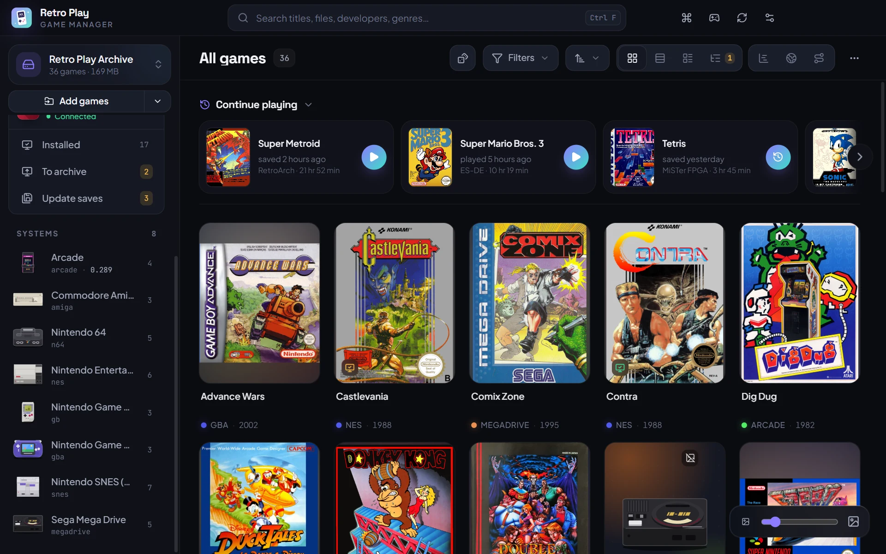
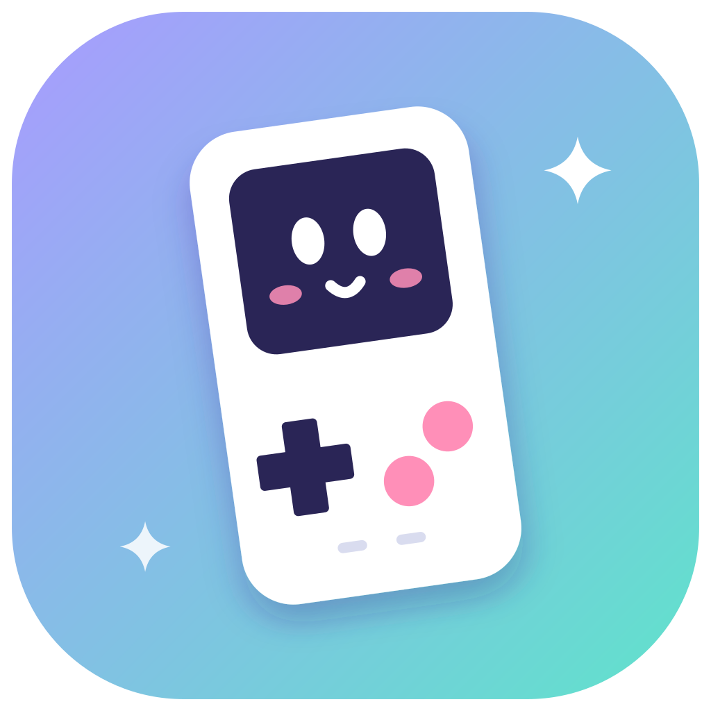
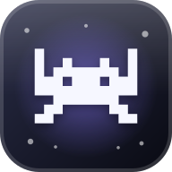
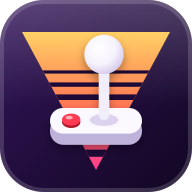
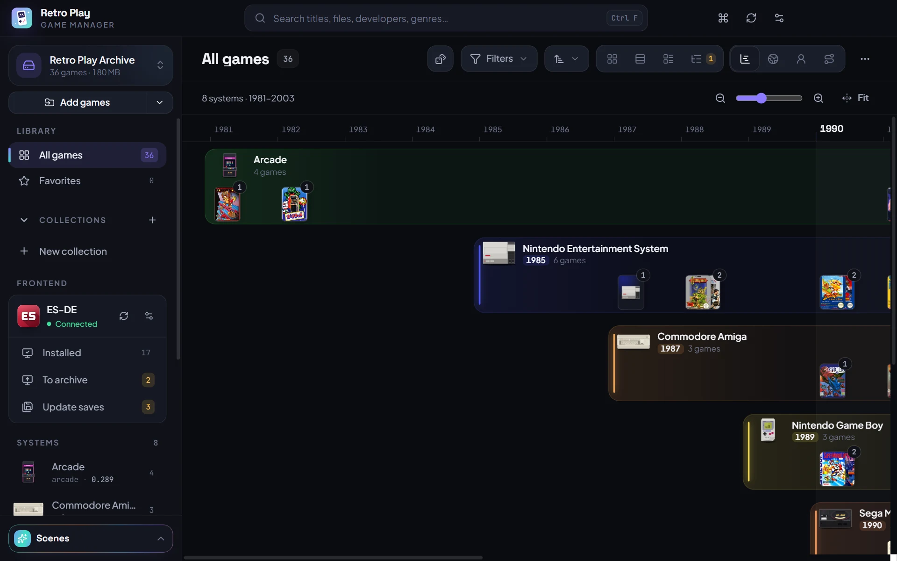
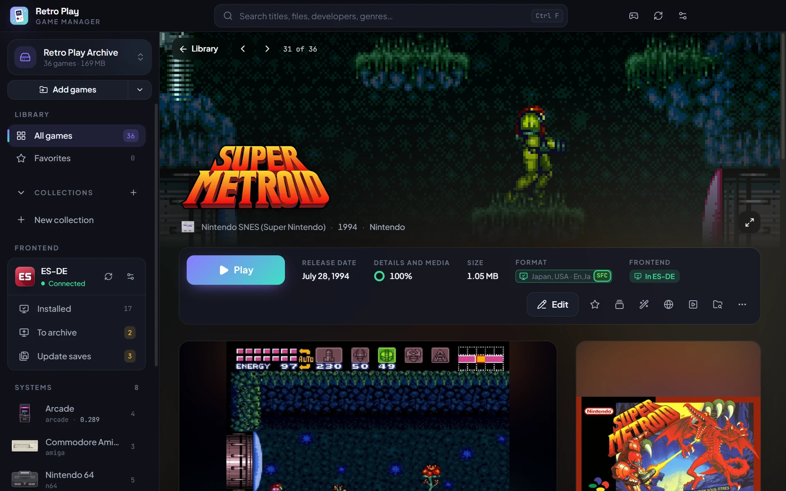
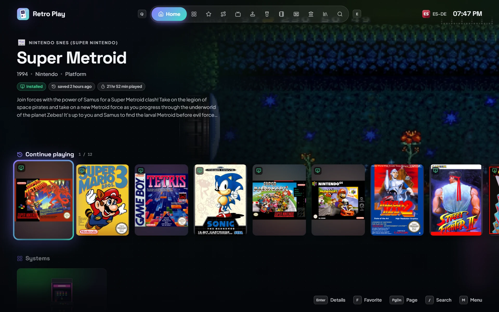
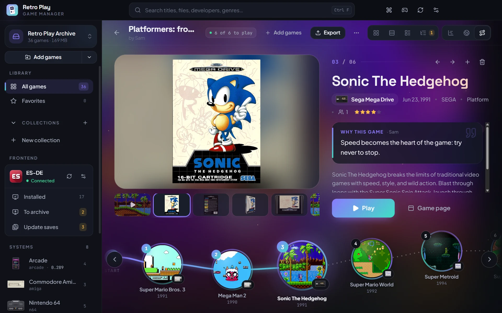
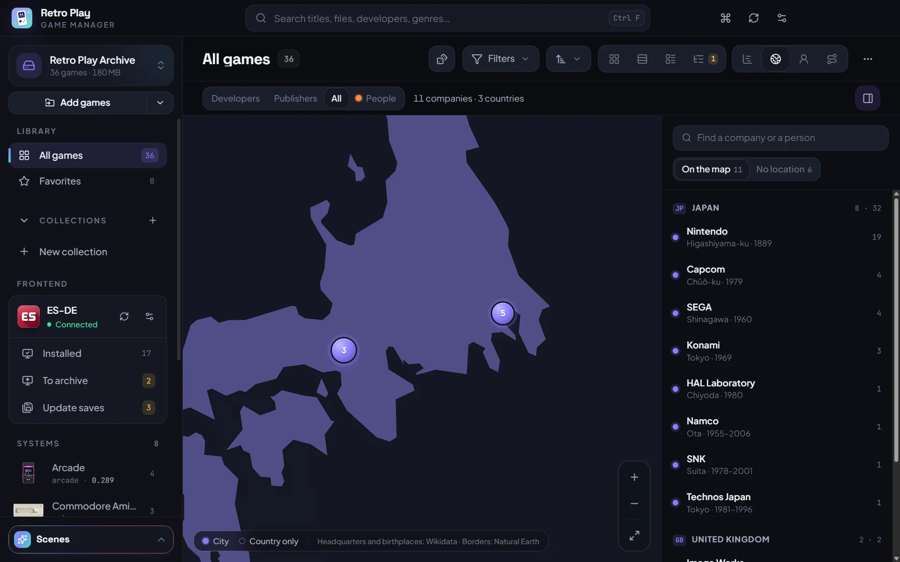

**Enjoying Retro Play? Buy me a coffee!** 
If it brought back a game from your childhood, or saved you an evening of fixing gamelists, 
a coffee on [Ko-fi](https://ko-fi.com/gerrykeys) is the nicest thanks. Every coffee turns into new features, 
more systems and frontends, and fewer bugs. ☕

 

  

# Retro Play Game Manager

**Your retro games, tidy and ready to play.**

[**Website & guide**](https://gerrykeys.github.io/retro-play-game-manager/) &nbsp;·&nbsp;
[**Download**](https://github.com/gerrykeys/retro-play-game-manager/releases/latest) &nbsp;·&nbsp;
[Guide](https://gerrykeys.github.io/retro-play-game-manager/)

 

Retro Play Game Manager keeps your games in order: you add them, fix titles and covers, and install them with one click on the frontend you play on.

## Supported frontends

<table>
  <tr>
    <td align="center" valign="top" width="20%">
       
      <b>ES-DE</b> 
      On your PC
    </td>
    <td align="center" valign="top" width="20%">
       
      <b>MiSTer FPGA</b> 
      On your network, or its SD card
    </td>
    <td align="center" valign="top" width="20%">
       
      <b>RetroArch</b> 
      On your PC, with its playlists
    </td>
    <td align="center" valign="top" width="20%">
       
      <b>RetroPie</b> 
      A Raspberry Pi on your network
    </td>
    <td align="center" valign="top" width="20%">
       
      <b>Batocera</b> 
      PC, Raspberry Pi or handheld on your network
    </td>
  </tr>
</table>

  

## How it works

| | |
|---|---|
| 🗄️ **The archive** | The folder with your games and everything that describes them: titles, covers, videos, saves. On your PC, a drive or a NAS. |
| 🖥️ **The app** | Shows the archive like a game store. Here you search, fix and complete: every change goes into the archive. |
| 🎮 **The frontend** | Where you play:  **ES-DE** or  **RetroArch** on your PC, a  **MiSTer FPGA**, a  **RetroPie** or a  **Batocera**. The app installs games there and starts them. |

## Download

Get the latest version from the [**Releases**](https://github.com/gerrykeys/retro-play-game-manager/releases/latest) page. It runs on **Windows 10 and 11 (64-bit)**.

| File | |
|---|---|
| `Retro-Play-Game-Manager-Setup-<version>.exe` | **Recommended.** Installs the app; it then updates itself. |
| `Retro-Play-Game-Manager-<version>-portable.exe` | No installation, runs from any folder. It updates itself too. |

What each version brought: the [**release notes**](https://gerrykeys.github.io/retro-play-game-manager/#/note-di-rilascio).

> [!NOTE]
> The app is not code-signed yet, so Windows SmartScreen may warn you the first time: click **More info → Run anyway**.

## Features

<table>
  <tr>
    <td width="50%"></td>
    <td width="50%"></td>
  </tr>
  <tr>
    <td align="center">The game page</td>
    <td align="center">Desktop Mode</td>
  </tr>
  <tr>
    <td width="50%"></td>
    <td width="50%"></td>
  </tr>
  <tr>
    <td align="center">Gaming journeys</td>
    <td align="center">The company map</td>
  </tr>
</table>

**Library**
- A cover grid, a list or a **timeline** of your systems year by year, fast even with tens of thousands of games.
- A **company map**: the developers and publishers of your games where they are in the world.
- **Gaming journeys**: games in a row, a note for each step, shared as a .zip with no game files.
- Instant search and filters, saved filters, **favorites** and **collections**.
- Video and screenshots on hover, and games compared side by side.
- A **command palette** (<kbd>Ctrl K</kbd>): games, systems, views, settings and actions in one box.
- **More like this** on every game’s page: the same series, developer or genre.

**Details and media**
- Edit titles, descriptions, dates, genres and ratings, one game or many at once.
- Covers, screenshots, videos and manuals: drag, paste, or pick them from the web.
- Automatic scraping from **ScreenScraper**, with **IGDB** as an extra source.

**Versions and formats**
- One game in several regions or kinds of file (for example LHA and ADF), duplicates joined in a click.
- Arcade games split by **MAME ROM Set**.

**Frontends**
- Connect  **ES-DE**,  **MiSTer FPGA**,  **RetroArch**,  **RetroPie** or  **Batocera**.
- Install and uninstall games with one click, and bring into the archive the games only the frontend has.
- **Play** straight from the app, wherever the game is installed.
- **Emulators and commands**: choose the emulator and the command line Play starts a system’s games with, or give a single game its own.

**Playing**
- **Continue playing**, **On this day** and a wheel that answers *What should I play today?*
- **Desktop Mode**: the app full screen, played with a joypad, with the games’ videos when you leave it alone.
- **Desktop Mode themes**: change its colors, fonts, music and even how each screen is laid out, or [make your own](https://gerrykeys.github.io/retro-play-game-manager/themes/index.html).
- **Play time** for every game, and **your retro year** told as a story, down to a card to share.
- **Cheats** for RetroArch, from the libretro database, on as the game starts.
- **Your phone as a remote**: browse and start games from the sofa, then a second screen with your notes, the manual and the cheats while you play.
- **Discord status**: your friends see what you’re playing.
- **Saves** kept safe in the archive, so you play on the  **MiSTer** and go on with your PC.
- **DIP switches** for arcade games: lives, coins and difficulty.

**Tools**
- **Verify with DATs** (No-Intro, Redump, MAME…): check your dumps and see what is missing.
- **Export** games to a .zip and **import** them into another archive.
- An **archive report** in one picture, and your **RetroAchievements**.
- **Check archive**: find and delete the media no game uses any more.
- An **MCP server**: an AI assistant like Claude Code can search, fix and install games for you.

The app is in **English** and **Italian**, with light and dark themes. If you like, it starts with Windows and waits beside the clock.

## Getting started

1. **Open or create an archive**: the folder that will hold your games. → [guide](https://gerrykeys.github.io/retro-play-game-manager/#/archivio)
2. **Add games** from a folder of ROMs. → [guide](https://gerrykeys.github.io/retro-play-game-manager/#/aggiungere)
3. **Scrape** them to get titles, covers and videos. → [guide](https://gerrykeys.github.io/retro-play-game-manager/#/scraping)
4. **Connect your frontend** and install the games you want to play. → [guide](https://gerrykeys.github.io/retro-play-game-manager/#/frontend)

Every task is explained in the [**guide**](https://gerrykeys.github.io/retro-play-game-manager/), each with a short animation of the real app.

## Help and feedback

- Questions? Start from the [common questions](https://gerrykeys.github.io/retro-play-game-manager/#/faq).
- Found a bug or have an idea? Open an [issue](https://github.com/gerrykeys/retro-play-game-manager/issues).

## Support the project

If you like Retro Play Game Manager, you can say thanks with a coffee:

